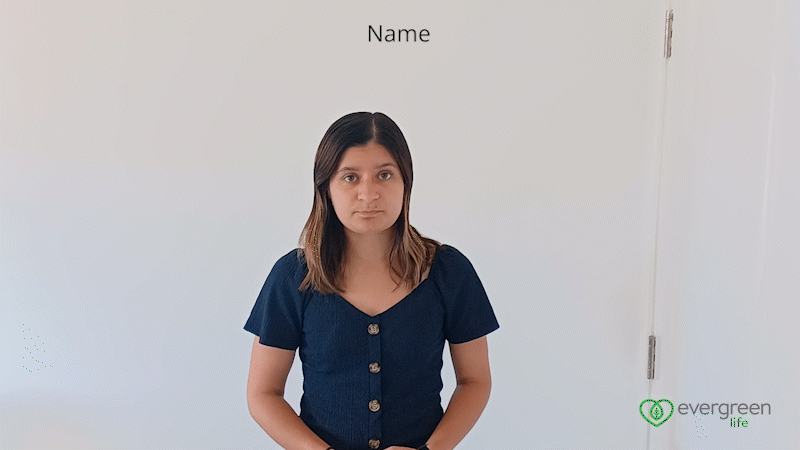

# SignBridge

**BSL (British Sign Language) → English → Moroccan Darija → Audio**

A real-time sign language translation app. A deaf person signs into the camera; the app translates the signs into English, then into spoken Moroccan Darija (Darija). Designed so a deaf person can hand their phone to a Moroccan seller and have their message spoken aloud.

---

## Demo



---

## How it works

1. **Sign recognition** — MediaPipe GestureRecognizer reads hand landmarks from the camera in real time
2. **Sign → English** — Groq LLM (`meta-llama/llama-4-scout-17b-16e-instruct`) interprets the recognized signs into a natural English sentence
3. **English → Darija** — Local seq2seq model (`BounharAbdelaziz/Terjman-Large-v2.0`) translates English to Moroccan Darija
4. **Darija TTS** — Local TTS model (`HAMMALE/speecht5-darija` + `microsoft/speecht5_hifigan`) speaks the Darija text aloud

---

## Stack

| Layer | Technology |
|---|---|
| Frontend | React 19 + TypeScript + TanStack Start + Tailwind CSS |
| Hand tracking | `@mediapipe/tasks-vision` — GestureRecognizer |
| Sign → English | Node.js proxy + Groq API |
| English → Darija | Python Flask + HuggingFace Transformers (local) |
| Darija TTS | SpeechT5 + HiFi-GAN via `sounddevice` (local) |

---

## Prerequisites

- **Node.js** v18+
- **Python** 3.9+
- **Groq API key** — free at [console.groq.com](https://console.groq.com)
- A microphone/speaker (for TTS audio output)

---

## Setup

### 1. Clone & install JS dependencies

```bash
git clone <your-repo-url>
cd quick-sign-english
npm install
```

### 2. Install Python dependencies

```bash
pip install -r requirements.txt
```

> First run will download the Terjman and SpeechT5 models from HuggingFace (~2–4 GB).

### 3. Set your Groq API key

Open `proxy.js` and replace line 3 with your key:

```js
const GROQ_API_KEY = "your-groq-api-key-here";
```

---

## Running the app

You need **three terminal windows** running simultaneously:

```bash
# Terminal 1 — React app (http://localhost:8080)
npm run dev

# Terminal 2 — Sign→English proxy (port 3001)
node proxy.js

# Terminal 3 — English→Darija + TTS server (port 3002)
python darija_server.py
```

Then open [http://localhost:8080](http://localhost:8080) in your browser.

---

## Input modes

| Mode | How it works |
|---|---|
| **Camera** | Press record, sign for 5 seconds, release. Signs are collected and sent for translation. |
| **Sentence builder** | Sign one word at a time — hold each sign for 1 second, drop hands between words. |
| **Upload** | Upload a video file. 3 frames are extracted and sent to Groq vision for recognition. |

---

## Recognized signs (built-in)

| Sign | Meaning |
|---|---|
| Thumb Up | good |
| Open Palm | hello / stop |
| Victory | peace |
| Pointing Up | me |
| ILoveYou | i love you |
| Closed Fist | a |
| Thumb Down | bad |

More signs can be added by providing a `public/templates.json` file (generated via `make_templates.py` from the Kaggle ASL Signs dataset) or by swapping in a pre-trained `.tflite`/`.onnx` landmark classifier.

---

## Project structure

```
├── src/
│   └── components/
│       └── SignBridgeApp.tsx   # Main UI + MediaPipe loop + sign recognition
├── proxy.js                   # Node HTTP proxy — Groq API calls
├── darija_server.py           # Python Flask — translation + TTS
├── make_templates.py          # (optional) generate templates.json from dataset
├── public/
│   └── templates.json         # (optional) pre-trained sign templates
├── requirements.txt           # Python dependencies
└── package.json
```

---

## Environment variables

Create a `.env` file in the project root if needed (already gitignored):

```
VITE_GEMINI_API_KEY=your_key_here   # optional, Gemini integration
```

---

## Known limitations

- Static pose recognition only — motion-based signs (e.g., "thank you") are not reliably recognized
- `ar-MA` browser TTS voice is rarely available; the app falls back to any `ar-*` voice
- MediaPipe loads from CDN on first page load (~10–15 seconds)
- Status indicator: red = loading, yellow = ready, green = hands detected

---

## License

MIT
